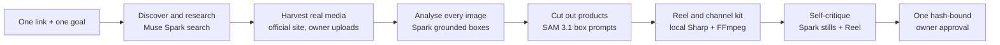
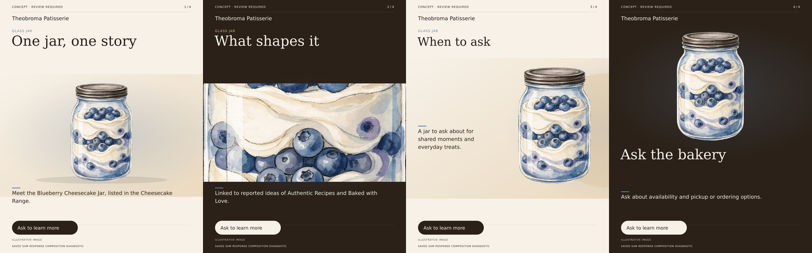

# Tickr Autopilot

**One link and one goal in. A reviewed, ready-to-approve campaign kit out.**

All AI inference runs on Meta-hosted APIs (`api.meta.ai`); the hosting runs only Tickr's own code.

## What it does

Tickr is for small businesses that can't afford a photographer, a videographer or an agency.

1. The owner pastes **one link**: their website, a Google Maps link or a Google `share.google` link.
2. The owner picks **one goal**, for example "Tell our story" or "Fill quiet hours".
3. Tickr works on its own from there. It researches the business and collects the business's real photos. It studies every image with Muse Spark and cuts out the real products with SAM 3.1. It then renders a vertical Reel and a full channel kit, and critiques its own output.
4. The owner reviews the kit and gives **one approval**. That approval is bound to the exact file hashes.

The kit covers Instagram feed, carousel, Stories and Reels, a Facebook ad, click-to-WhatsApp creative and WhatsApp Status.

Tickr never publishes, never spends ad budget and never contacts anyone.

## Try it

- **Live app:** https://vn-envy--tickr.us-east.modal.run. It is behind an access code, which the team can provide on request.
- **Demo video:** [demo/tickr-demo.mp4](demo/tickr-demo.mp4) (2:18): a real run on the hosted app, from one link to the finished kit, with each Meta model labelled as it works. The script and timeline are in [demo/SCRIPT.md](demo/SCRIPT.md).
- **Judge guide:** [docs/JUDGES.md](docs/JUDGES.md) explains what to look at and where each capability lives in the code.

## How it uses Meta models

| Model | Capability used | Role in Tickr |
| --- | --- | --- |
| `muse-spark-1.3` | Native web search with citations | Finds the business, its offerings and its story from one link, with sources kept |
| `muse-spark-1.3` | Strict JSON output | Research analysis, campaign choice and channel copy |
| `muse-spark-1.3` | Image grounding (boxes on a 0–1000 grid, up to 24 images per request) | Studies every harvested photo and points at the main subject |
| `muse-spark-1.3` | Video understanding | Writes a shot log for the owner's clips |
| `muse-spark-1.3` | Vision and video critique | Reviews the finished stills and the Reel, with grounded findings |
| `sam-3.1` | Box prompts | Cuts out the exact object Spark pointed at |
| `sam-3.1` | Concept prompts | Fallback when there is no usable box |
| `sam-3.1` | Video tracking | Follows the product through the owner's footage for the tracked Reel |
| `muse-image-1.0` | Image generation | Labelled backdrops, or a labelled illustration when no real photo can be used. It never puts generated pixels on the product. |

## Spark points, SAM cuts

Muse Spark draws a box around the main subject of each photo. Tickr turns that box into a SAM 3.1 box prompt, so SAM cuts out that specific object instead of guessing from a product name. Concept prompts are the fallback. Each cutout keeps the original photo's pixels and only changes transparency. Every Reel's composition ledger records `generatedPixelsOnSubject: 0`. With owner footage, SAM 3.1 tracks the product through the clip, and the Reel sets the headline behind the moving subject. Without footage, the hero photo's SAM layers drive a depth Reel.

## Architecture

Tickr is one Next.js app plus a durable background worker, with SQLite for state. Rendering is local: Sharp for stills and FFmpeg for video. All model calls go to Meta-hosted APIs. Each paid step reserves budget and stores the raw response before decoding it. After a crash, saved responses are reused and an uncertain paid request is not repeated automatically.



- [docs/AUTOPILOT.md](docs/AUTOPILOT.md): the Autopilot pipeline, request budgets, safety rules and live results.
- [docs/ARCHITECTURE.md](docs/ARCHITECTURE.md): the full system design.

## Safety and honesty guarantees

- **No publishing.** Tickr never publishes, spends ad budget or messages anyone. The output is a kit for the owner to review.
- **One exact approval.** The server re-hashes every file before it records the approval. Withheld files are left out of the approval.
- **No generated product pixels.** Products are always real source pixels. Generated imagery is labelled as a backdrop or an illustration.
- **Provenance labels.** Every frame and still is labelled as a concept and names its source, for example OWNER PHOTO · SAM CUTOUT, WEBSITE IMAGE, AI BACKDROP or ILLUSTRATIVE IMAGE.
- **Evidence, not instructions.** Website text is treated as evidence. Original excerpts, provider-cited summaries and model-linked summaries are kept apart. A proposed offer is never presented as a verified fact.
- **Copy claim repair.** If the selected sources can't support a copy line, that line and the lines read together with it (the same ad, scene sequence or script) are replaced by neutral lines. Every replacement, with its original text, is recorded in `copy-claim-repairs.json`.
- **People and rights.** The director excludes possible minors, people without recorded consent, third-party logos and signage. Owner uploads need consent attestations first.
- **No Google page scraping.** Maps and `share.google` links are resolved from redirect headers only. Tickr never fetches Maps pages or calls Google Places.
- **Credentials stay server-side.** Keys live in the environment or a Modal Secret and never appear in files, logs or exports.
- **Stops instead of guessing.** When discovery can't find usable sources, Tickr stops and asks for a better link.

## Live results

These are recorded results, not projections.

- **4 Nov 2026, live capability probe** (`npm run autopilot:check`, synthetic media): 7 of 7 steps passed.
  - Spark grounding returned boxes for both subjects.
  - SAM 3.1 box prompt: confidence 0.988. Concept prompt: confidence 0.922.
  - Spark shot log passed.
  - SAM 3.1 video tracking held the subject in 120 of 120 frames.
  - The Spark critic reviewed a still and an inline Reel.
  - List-price estimate about USD 0.06. This is an estimate, not an invoice.
- **5 Nov 2026, hosted run: Grandma Daphne's Bakehouse (Hyderabad)**, website link with a story goal. It completed in 3 min 40 s.
  - Spark analysed 12 official-site photos.
  - 3 photos were excluded with reasons: a person without consent, a logo and interior signage.
  - SAM 3.1 produced 3 cutouts, and Tickr rendered a still-depth Reel.
  - The critic raised 10 findings, none blocking. They included ragged edges on the hero cutout and text contrast.
- **Earlier:** Theobroma completed with a labelled illustration, because its image CDN blocks downloads.
- **Tests:** `npm run check` passes with 951 tests on the deployed commit `6c0aaec`.

Known limitations and work in progress:

- **Maps discovery.** Maps-link discovery depends on Meta search returning usable sources. In 3 of the last 5 Maps attempts it did not. In those cases Tickr stopped and asked for a better link.
- **Website fallback (in progress).** When search comes up short, Tickr will fall back to reading the owner's own website (a permitted, SSRF-safe reader) to find the business.
- **Mask-quality gate (in progress).** A fix for ragged cutout edges, like the one the critic flagged on the 5 Nov run.
- **Graph connector.** The optional Instagram/Facebook connection is implemented but not yet verified live.

## Run it locally

Requires Linux, Node.js 24, npm 11.9, FFmpeg, Chromium and `setsid`. Setup needs access to the npm registry and Prisma binaries.

```bash
git clone https://github.com/vn-envy/Tickr.git
cd Tickr
npm ci                 # pinned dependencies
npm run db:setup       # Prisma client and non-destructive SQLite migrations
npm run check          # ESLint, TypeScript and the test suite (no paid calls)
npm run build
TICKR_SERVER_MODE=production bash scripts/start.sh   # app on port 3000 plus the worker
```

`bash scripts/setup.sh` runs `npm ci` and `npm run db:setup` together. Use `bash scripts/start.sh` without the production flag for development.

For live runs, set `META_API_KEY` in the process environment before starting. Never put it in a file. See [.env.example](.env.example) for optional settings. The tests and media diagnostics run without a key.

Verification commands:

```bash
npm run media:check                  # local renderer contracts, including the depth Reel
npm run autopilot:check -- --dry     # full capability probe with fake Meta clients (offline)
npm run autopilot:check              # LIVE probe on synthetic media; needs META_API_KEY
npm run smoke                        # persistence/API check against a running app and worker
npm run meta:check                   # read-only model listing; needs META_API_KEY
```

## Hosting on Modal

Modal hosts Tickr's own code only, as one persistent container. It runs no models. All inference stays on Meta-hosted APIs.

- Run outputs and SQLite snapshots are kept on a Modal Volume.
- Credentials live only in Modal Secrets: `tickr-runtime`, plus `tickr-keys`, which is created once.
- A public deployment keeps the access-code gate on.
- Always deploy with `modal deploy --strategy recreate`.

Full steps are in [deploy/README.md](deploy/README.md).

## Repository map

- `app/`, `components/`: the web app. `components/autopilot/` holds the intake, the director's room and the review screen.
- `lib/autopilot/`: the Autopilot pipeline: harvest, analyse, select, direct, produce, critique, budget and report.
- `lib/agents/`: the Spark critic and its deterministic fixes.
- `lib/meta/`: Meta adapters: Spark media analysis, SAM 3.1 segmentation and video tracking, Muse Image and the Graph connector.
- `lib/research/`, `lib/network/`: link resolution, research, evidence and the restricted official-site reader.
- `lib/media/`: media acquisition, the CDN allow-list, uploads, object layers and masks.
- `lib/campaign/`: copy, channel rendering and archive export. `lib/campaign/cinema/` holds the Reel renderer.
- `lib/jobs/`, `prisma/`: the durable worker, checkpoints and SQLite.
- `deploy/`: Modal hosting.
- `scripts/`, `tests/`: setup, live and offline checks, and the test suite.
- `docs/`: architecture, Autopilot, media pipeline, demo notes and the verification log.

## Details

### Manual studio and request budgets

The earlier step-by-step studio is still available behind "Advanced". Request ceilings differ by mode:

- **Manual run:** at most 6 Meta requests.
- **Autopilot run:** at most 28 requests, with per-role caps in `lib/autopilot/budget.ts`.

Research tool actions have their own separate limits.

Uncertain paid requests are never retried automatically. Completed responses and hashed artifacts allow local recovery. Ordinary tests make no paid model calls.

To run a live link-only manual campaign from the command line (makes paid Meta requests):

```bash
npm run link:smoke -- --live-meta --url=https://theobroma.in --report=my-demo
```

### Data and access

SQLite, generated media and private responses live under the ignored `.data/` folder and are not part of a clone. Setup applies migrations without resetting existing data.

When `TICKR_ACCESS_CODE` is set, an access-code gate protects the app (`proxy.ts`, `lib/access.ts`). The Modal deployment requires it. Locally the gate is off by default. Tickr has no per-user accounts.

### Earlier runs and media verification

Earlier link-only manual runs produced reviewable kits for Grandma Daphne's Bakehouse, Theobroma and Tiger Lily Coffee & Bistro. Tiger Lily's original SAM attempt failed, so that saved kit uses the crop fallback. See the [demo guide](docs/DEMO.md), the [media pipeline](docs/MEDIA_PIPELINE.md) and the [verification log](docs/SETUP_VERIFICATION.md).



*A local rendering diagnostic using a saved, genuine SAM response and a Muse illustration. These are example layouts, not real product photography or an approved brand campaign.*

### Scope

Outputs are campaign concepts that need owner review, not approved advertisements. Public evidence may be incomplete. Tickr does not claim complete review coverage, a validated competitive gap or a measured lift in conversions. WhatsApp output is creative and suggested reply copy only.

Further reading: [generic research design](docs/GENERIC_RESEARCH.md), [build plan](BUILD_PLAN.md).

### License note

Tickr uses Meta SAM Materials through the pinned, unmodified `@meta-sam/parser` package under the [Meta SAM License](docs/licenses/meta-sam-LICENSE.txt). Hosted SAM performs inference, and the local parser decodes its masks. Remotion is used for a separate rendering diagnostic. The campaign renderer uses Sharp and FFmpeg.
