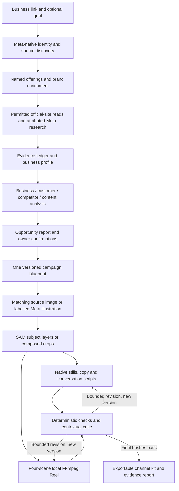

# Tickr architecture

Design contract, updated 3 November 2026. [BUILD_PLAN.md](../BUILD_PLAN.md) defines scope, schedule and exit tests; README records implementation status.
The [user's final architecture](reference/final-architecture-2026-11-01.txt) supersedes the archived visual-first plan.
The selected hero is **Grandma Daphne's bakehouse**, listing reference `https://maps.app.goo.gl/nNy6iYx9r4GaU7YY8`. Its storytelling/differentiation goal is confirmed. The URL-only worker run resolved its name hint, found its Instagram profile and produced a complete review-only story concept. Exact locality remains unresolved. Accepted model-linked story summaries retain their retrieval metadata and are not original page quotations.

The [official event page](https://dev.meta.ai/events/global-hackathon) and [Official Rules](https://cerebralvalley.ai/e/meta-ai-developer-hackathon/waiver) were successfully read November 1. Deadline, judging weights, Meta-product use, original-work/OSS provisions and IP terms are recorded in [the build plan](../BUILD_PLAN.md#verified-event-requirements-and-remaining-submission-details).
The event allows hosted/open-weight options; the user's Meta-hosted-only inference requirement remains the project's stricter boundary. Video duration, public-repository mandate and “new work only during the event” wording are still unverified by the retrieved public rules.

## Workflow



A bounded TypeScript state machine owns transitions. Research tasks may request evidence and revise hypotheses inside a shared budget.
A persistent local worker claims one run with a database lease; API handlers create/read/resume jobs instead of owning their lifetime.
The same deployment contains Next.js, the worker, Prisma/SQLite and local media. `scripts/start.sh` starts the web app and worker together. A Python service is unnecessary unless a specific allowed processing task requires it.
Long-running jobs and SQLite/assets need persistent storage; an ephemeral request-only deployment is insufficient.

## One-shot Autopilot (4 November 2026)

With `autopilot: true`, the owner's link and goal start one durable run that continues without further input until it reaches a review-ready kit:

```mermaid
flowchart LR
  L[Link + goal (+ optional uploads / Meta login)] --> D[Discover + enrich]
  D --> R[Analysis report]
  R -->|deterministic choice, recorded basis| S[Selection]
  S --> H[Harvest media: website gallery, owner uploads, owner Meta media]
  H --> A[Spark analyzes every image + shot logs for videos]
  A --> P[Deterministic director plan]
  P --> G[SAM 3.1 box-prompted cutouts]
  P --> T[SAM 3.1 video tracking]
  G --> K[Channel stills + carousel from real photos]
  T --> V[Tracked cinema Reel + SAM overlay]
  G --> V2[Depth Reel fallback]
  K --> C[Spark critic + deterministic fixes]
  V --> C
  V2 --> C
  C --> E[Export + quality record]
  E --> O[Owner's single hash-bound approval]
```

- The research report's recommendation (or the highest complete score) is selected automatically and stored as an immutable `selection` checkpoint with its basis; manual runs still wait for the owner.
- Autopilot runs carry a larger, explicit per-run ceiling (`modelCallLimit`) and per-role caps (`lib/autopilot/budget.ts`); every paid step still writes its requested-marker first and is never retried automatically.
- The director (`lib/autopilot/director.ts`) is deterministic. It excludes possible minors, people without recorded consent, third-party branding and unapproved price/offer text before ranking.
- Progress is written to a validated "director's room" state (`lib/autopilot/public-state.ts`) that lists only derived previews; private originals, raw responses and tokens never appear there.
- Approval (`lib/jobs/approval.ts`) re-hashes every approvable file and binds to a manifest digest; it records approval of concept material and never publishes.

## Artifact contracts

All stage outputs validate against versioned Zod schemas. JSON schemas constrain model output when the verified endpoint supports them; server-side validation remains mandatory.
A schema pass establishes shape, not truth or source support.

| Artifact | Required content |
| --- | --- |
| `BusinessIntake` | Required URL/reference (or manual name/locality); optional goal, identity hints and assets/rights records |
| `BusinessDiscovery` | Matched/ambiguous/unresolved identity, nullable locality/category, retrieved links, source IDs, query/tool count and warnings |
| `EvidenceItem` | Claim, source/upload ID, URL, excerpt/image region, observation/retrieval time, provenance, source scope, freshness and contradictions |
| `BusinessProfile` | Supported offerings/capabilities, owner constraints, brand inputs, material unknowns and evidence IDs |
| `ResearchReport` | Four analysis tasks, bounded competitor set, customer sample, content findings, coverage and unavailable evidence |
| `OpportunityReport` | Reputation/visibility/conversion findings; up to three supported opportunities; dimension scores/unknowns, rationale, counterevidence and test |
| `CampaignBlueprint` | Objective, audience hypothesis, selected need/differentiator, message, proposed/approved offer, terms, CTA, evidence IDs and channel plan |
| `CreativeManifest` | Per-channel copy/media specifications, source asset dependencies, storyboard, production dimensions and generation/render provenance |
| `QualityReport` | Per-version checks, evidence references, severity, requested corrections, final hashes and pending owner confirmations |
| `ExportManifest` | Actual filenames/checksums, channel completeness, blocked outputs, eligibility notes, strategy and review report versions |

Keep source-supported facts, observed signals, owner-stated facts, inferences and proposals distinct.
An advertising decision is contextual: provenance, freshness, owner approval, channel rules and vertical constraints all matter.
Use explicit unknowns rather than invented facts, calibrated-looking confidence values or synthetic evidence.

Each opportunity uses the plan's documented 30I/25E/20D/15F/10C heuristic.
Dimension inputs and reasoning remain visible; incomplete inputs produce an unscored hypothesis and a coverage report.
The ranking is an internal prioritization tool, not a prediction of revenue, conversion or competitive superiority.

## Data and filesystem

Use Prisma/SQLite for businesses, runs, evidence, stage checkpoints, opportunities, blueprint versions, asset versions, quality checks and approvals.
Store large media/source snapshots on local disk, referenced by content hash and generated asset ID; avoid embedding base64 media in database rows.
An FTS index may support local evidence lookup without an external embedding service.
Keep runtime data, uploads, credentials, caches and generated media in ignored locations.
Only sanitized fixtures explicitly approved for repository/demo use belong under version control.

Suggested logical layout; directories are added as their implementation lands:

```text
app/                        UI and request handlers
lib/meta/                   Meta transport and capability adapters
lib/research/               Restricted public-site fetch and extraction
lib/agents/                 State machine and analysis/strategy/critic stages
lib/schemas/                Versioned artifact contracts
lib/verticals/              Four declarative research and review packs
lib/rendering/              Sharp/SVG layout and export
lib/jobs/                   Persistent run claims, budgets and checkpoints
remotion/                   Storyboard-driven Reel compositions
prisma/                     Schema and database initialization/migrations
scripts/                    Worker and local setup entry points
tests/fixtures/              Clearly labeled synthetic/sanitized sources
tests/integration/           Meaningful workflow/recovery checks
tests/evaluation/            Frozen-input comparisons and score reports
```

## Network boundary

There are three primary network paths, plus a fixed-host link-routing resolver described below:

1. **Meta API client:** server-side requests to account-verified Meta-hosted inference endpoints, initially `api.meta.ai`, with inline image and video bytes; no external generated-image download is required. No third-party or local inference fallback.
2. **Restricted public-site reader:** HTTP retrieval of permitted official business/competitor pages. A URL does not authorize general crawling or unrestricted model-directed networking.
3. **Owner-authorized Meta Graph connector (optional):** after the owner signs in with Meta and attests to their media rights, a fixed-origin client calls `graph.facebook.com` to list the owner's own Page and linked Instagram professional-account media. Media bytes are downloaded only from allowlisted Meta CDN hosts through the same SSRF-safe pinned transport; no token or credential is ever sent to a CDN. Tokens are encrypted at rest with `TICKR_SECRET_KEY` and can be revoked. The connector is disabled unless `META_APP_ID`, `META_APP_SECRET`, `META_OAUTH_REDIRECT_URI` and `TICKR_SECRET_KEY` are configured.

All other external runtime APIs are excluded: Google Places, search providers, Treg services, storage services, hosted image/video utilities and non-Meta model hosts.
Meta social/marketing adapters are optional, credential-scoped additions; they do not share arbitrary owner-token access with research tools.
The browser communicates with our backend. Model credentials remain server-side and are redacted from logs/errors.

The site reader must enforce public HTTPS destinations, canonical host rules, DNS/IP validation, redirect revalidation, strict time/size/page limits and permitted MIME types.
The separate reference resolver accepts only the supplied Maps short-link host and reads its routing redirect through the cloud proxy. It stops before fetching the allowlisted Maps target. The routing name is an identity hint, not evidence of locality, offerings or story.
Reject loopback, private, link-local, metadata and other non-public destinations, userinfo URLs, unexpected ports, and redirects into forbidden ranges.
Do not bypass login/access controls or scrape Google Maps. Honor source access restrictions and retain attribution.
Guard against DNS rebinding at connection time. Through the trusted environment proxy, resolve/validate all public IPv4 answers locally, CONNECT only to the chosen IP:443, then verify TLS against the original hostname. Proxy credentials stay on CONNECT and never reach the origin. No hostname-tunnel fallback or automatic alternate-address retry is allowed.
Extract website text as untrusted data; strip active content and never execute instructions found in it.
Local rendering uses bundled fonts/assets with external requests disabled.
Uploads require file-type/content validation, decoded-image limits, randomized storage names and safe path handling.
Public source evidence and private owner uploads must remain distinguishable in export and replay controls.

## Meta capability adapters

Expose roles rather than hardcode assumed universal model IDs:

- Research/orchestration and visual understanding.
- Strategy and contextual critique.
- Image generation/editing.
- Segmentation.

The authenticated catalog check exposes `muse-spark-1.3`, `muse-wonder-1.0`, `muse-image-1.0` and `sam-3.1`; the Meta credential is saved and active.
A complete synthetic source-to-concept flow now uses Spark 1.3 `POST /v1/responses` with strict `text.format` JSON. The server checks exact source quotes, source roles, reference IDs and score anchors; this establishes attribution, not complete semantic truth or owner approval.
The worker now performs bounded Meta-native discovery with `max_tool_calls: 5` and requested retrieval metadata. Original snippets, provider-annotated summaries and model-written summaries referencing actual retrieved URLs have separate provenance. The completed bakery run used three model-linked descriptions of one Instagram profile. They can inform review-only descriptive themes but cannot authorize quantitative, promotional or medical promises. Muse Image generation passes live tests using `/images/generations`, one inline PNG, bounded response bytes and disabled implicit web/image search. JSON reference editing is implemented but live-untested.

SAM 3.1 uses the same fixed-origin client with `POST /v1/responses`, inline image bytes, a text subject prompt, `stream: false`, `store: false`, and one-bit masks with confidence requested in metadata. The official parser decodes the returned mask tokens; Sharp applies the mask locally, with no local model inference. One live capability probe returned a usable jar mask in 3.225 seconds with confidence 0.9726 and `images_processed: 1`. Zero token usage does not establish zero cost. This independently verifies the SAM adapter. The exact saved response also passed production subject composition and twelve-asset rendering offline, preserving source RGB and alpha within the mask. Tiger Lily’s original live SAM attempt failed and its completed kit uses the explicit crop fallback; its failure cause was not retained. See [media pipeline](MEDIA_PIPELINE.md) for the precise implementation and probe scope.
The [official structured-output guide](https://dev.meta.ai/docs/structured-output) specifies `text.format` for Responses and `response_format` for Chat Completions; do not interchange them. Server-side validation is still required.
Remaining model-role operations, supported media inputs, retrieval citations, rates and quotas require verification. Catalog presence alone is insufficient.
Record a capability result for each tested operation: model ID, endpoint shape, time, response shape, limitations and success/failure. Never store keys.
If Meta-native search cannot show an actual retrieval and attributable source, do not claim the model visited the supplied URL.
If a preferred reasoning model is unavailable, use an account-verified Meta-hosted role substitute and disclose it.
If a production capability is unavailable, pause the affected stage or use an explicitly supported local rendering path; never silently change providers.

The central client handles timeouts, bounded response bytes and sanitized errors without automatic retries. Worker reservations limit each run to six model requests and two concurrent jobs: at most four text requests plus two visual requests across Muse Image and SAM. Native retrieval actions are separately bounded inside text requests. Copy preflight occurs before reservation; completed copy, image, mask and backdrop checkpoints avoid duplicate requests.
Unknown pricing remains unknown; a dollar forecast cannot be computed from invented rates.
No raw credentials, owner-sensitive prompt bodies or entire network headers belong in trace events.

## Media and channel contracts

One immutable blueprint drives every renderer. Facebook and Instagram copy, carousel narrative, Reel timing and CTWA scripts are intentional adaptations.
Ready assets can use only supported claims and owner-approved offer terms. Proposed offers stay visibly pending.
Sharp/SVG renders precise typography, prices and branding. Real products/people should remain deterministically composited from authorized source pixels.
Generation and segmentation are creative aids; neither masks nor semantic similarity alone proves identity fidelity.

The implemented visual path chooses by available evidence and source pixels:

| Input | Visual requests | Local composition |
| --- | --- | --- |
| Named offering, no acquired matching image | Muse illustration, then SAM subject mask | Unchanged decoded subject RGB with masked alpha over a proposed palette |
| Acquired matching source image | SAM subject mask, then Muse backdrop if the mask is usable | Source cutout over an explicitly generated empty backdrop |
| Story without a named offering or acquired source image | Muse symbolic illustration; SAM skipped | Hero/detail/story/action crops of the shared illustration |
| Failed or unusable segmentation/backdrop | No automatic repeat | Original image crops or a local palette, with recorded status and warnings |

The source hash binds masks to their image. Bounds, decoded dimensions and coverage are checked before composition. The full-resolution cutout preserves decoded RGB and multiplies original alpha by the mask; subsequent layout resizing resamples pixels normally. A generated illustration remains an illustration after segmentation. Source attribution and unknown image rights remain visible; an accessible image is not publication approval. The implementation and license notice are documented in [media pipeline](MEDIA_PIPELINE.md).

The Reel is a real multi-scene 9:16 MP4 with hook, proof, value/occasion and brand/CTA scenes.
The current concept path uses Sharp/SVG scenes and local FFmpeg animation/encoding directly; Remotion remains a separate diagnostic. Hero, detail, story and action compositions reuse the same source, cutout and optional backdrop with distinct crops, placement and typography. The 12-second, 1080×1920, 30 fps H.264 Reel adds restrained whole-scene pan/zoom and transitions; this is deterministic scene animation, not generated video or independent subject motion.
Production rendering must satisfy actual license terms and the runtime network boundary. Development diagnostics do not establish production entitlement or full network isolation; use a permissible local FFmpeg implementation if compliant Remotion deployment requires incompatible external service calls.
Validate the file and inspect sampled frames/transitions/end card; source/image-level QA alone cannot pass the rendered video.

CTWA output includes a placement creative, primary copy, opener, three response suggestions, qualification question and conversion action.
WhatsApp Status output is a separate vertical concept with placement eligibility explicitly unknown until verified.
Cloud API templates, approved outbound messaging, live conversations and bookings are separate integrations and statuses.
An exported script must never be represented as a deployed automated agent.

## Checkpoints, revision and export safety

Each checkpoint stores stage state, schema/version, input and dependency hashes, output IDs, attempt count, usage and failure reason.
Resume only if its dependencies still match. Changed evidence invalidates affected opportunities/blueprints; changed blueprints invalidate dependent media/reviews.
Use transactional state changes and atomic asset publication to prevent half-written exports.
A recovery test must interrupt after research and confirm resumed production does not pay to rerun valid research.

Bound tool operations, total model requests, generation requests and revision rounds; retries consume budget.
Reserve capacity for final review and pause with a reason when required work cannot fit.
Every asset revision gets a fresh version. The final verdict binds media bytes, rendered copy, blueprint and review-rules version.
Export recomputes hashes and rejects stale approvals. Unresolved critical findings block ready-to-use status.
The ZIP contains only declared files; paths cannot escape the output root. The manifest records missing/blocked channel outputs honestly.

## Verification layers

- Deterministic foundation: contracts, score/unknown behavior, state transitions, asset/version dependency invalidation, export contents.
- Safety-critical IO: prohibited URL/redirect destinations, file/path boundaries, credential redaction and rendering network isolation.
- Live Meta capability checks: catalog, native discovery/enrichment, strict-JSON analysis/copy, Muse Image generation and one SAM 3.1 segmentation probe passed. A saved real SAM response passed full layer/asset/Reel rendering offline. Tiger Lily’s live run completed with Muse artwork and an honest crop fallback after a SAM failure; it does not count as live segmentation success. Original official-page reading now works; connected-account media and reference editing remain open.
- Real hero slice: business evidence through ranked opportunities, followed by the complete kit and final QA.
- Four-case evaluation: all verticals, final MP4 playback, blind quality review, reproducible baseline and disclosed failures.

Fixture/replay modes carry explicit labels. A working fixture, page render or passing build does not establish live inference, complete research or product readiness.
The durable worker/API and concept-export flow are implemented. Immutable input/source/report/selection/campaign checkpoints, lease recovery, explicit safe rendering retry and manifest-bound downloads are tested. Source quote validation and copy guards do not replace the planned contextual critic and owner approval. See [setup verification](SETUP_VERIFICATION.md) for the maintained execution record.

## Product and visual grounding

`BusinessEnrichment` retains named offerings and story/positioning/tone signals with source IDs. The selected opportunity passes only eligible business evidence to the copy writer: source-linked reported signals can support review-only descriptive concepts without being relabelled facts. Numerical promises, prices, contact details and consequential claims still require stronger support.

`CampaignCreativeBrief` binds the chosen offering or literal source phrase, brand story, proposed palette and four scenes to that evidence. A named offering must match the dossier and appear across all channel adaptations. Standalone production labels are transferred to review notes; bounded editorial numbering is distinguished from business quantities.

The visual stage first attempts exact product-labelled official media. The only additional CDN currently verified is `cdn.uengage.io`, limited to exact official-HTML references under `/uploads/` and `/brand_logo/`, with its own robots checks and the same IP/TLS/raster limits. If acquisition is unavailable, one Meta illustration can be requested. Original files and illustrations are never interchangeable statuses. A requested-image checkpoint prevents repeating uncertain paid work; completed bytes are hash-checked before reuse.

The export includes the normalized shared image, any completed subject/mask/backdrop assets, and a product/brand dossier with the source map for every included record. The visual record retains source hash, composition type, background origin and segmentation outcome. Private machine paths and raw response diagnostics stay out of the ZIP. See [product grounding](PRODUCT_GROUNDING.md) for executed examples and remaining limits, and [media pipeline](MEDIA_PIPELINE.md) for the implemented layer workflow.


## Generic research and exact-location context

The November 2 user direction supersedes the closed four-category runtime design. `vertical` remains the legacy storage/API field name but now accepts a bounded free-form category. Optional historical playbooks supply examples; a generic playbook supports any business. An unknown category does not block an otherwise source-attributed identity.

Discovery retains Maps routing name, place-pin versus viewport coordinates and place/feature identifiers as hints, never proof of a branch. The matched brand and the branch status (`matched`, `candidate`, `unresolved`) are separate. Only a supported matched branch can fill the resolved locality; a candidate remains visible for review. Discovery makes at most five native actions, then an adaptive investigation makes at most ten across relevant public sources. This is bounded research, not exhaustive web scraping.

Each new source can carry location scope, an attributed location anchor, publication/validity dates, a retained date anchor and temporal status. A retrieval timestamp is not a publication date or offer validity. Impossible dates, inverted windows and unanchored metadata fail validation. Other branches and historical material remain inspectable but cannot authorize current offerings at the selected location. Current offer classification requires an exact-location original source with a supported active validity window; an undated source or AI summary can support only qualified descriptive context.

Investigation returns a research plan, named offerings, brand signals, customer/competitor/seasonal/content/operations insights, and coverage by research area. Analysis receives that provenance and the current date. Creative briefs retain linked insight IDs, timing rationale and a seasonal theme explicitly classified as proposed or source-supported. Reels and channel copy use the selected brief; a proposed Diwali idea does not assert an existing promotion.

All new fields are optional when restoring historical runs. Runtime workflow versioning keeps older results distinct from the expanded investigation. The same Meta-only inference and bounded official-site network paths apply.
