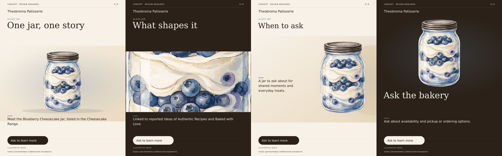

# Muse Image and SAM campaign media

Updated 4 November 2026. This describes the implemented pipeline in [visual.ts](../lib/campaign/visual.ts), [layers.ts](../lib/campaign/layers.ts), [render.ts](../lib/campaign/render.ts) and [reel.ts](../lib/campaign/reel.ts). Muse Image generation and SAM 3.1 segmentation have independent live capability results. The new combined campaign path is implemented; its live end-to-end result is pending and will be recorded in [setup verification](SETUP_VERIFICATION.md).

## One creative brief, reusable subjects

Research selects a source-attributed offering or story and proposes a palette, art direction and four scenes. The engine first attempts to acquire an exactly labelled offering image from the official site. It stores an eligible image locally with its source-page URL, image URL and unknown-rights status. A matching label is an attributed association, not independent proof of product identity or permission to publish. Network failures and unavailable media remain explicit.

The visual decision depends on what was acquired:

| Situation | Meta visual sequence | Composited result |
| --- | --- | --- |
| Named offering with no matching source image | Muse Image illustration → SAM subject segmentation | Isolated illustrative subject over a local palette background |
| Matching source image available | SAM subject segmentation → Muse Image empty backdrop, only if segmentation is usable | Source pixels over a disclosed generated backdrop |
| Story without a named offering or acquired source image | Muse Image symbolic illustration; skip SAM | Composed crops that retain the shared story image |
| Unusable mask or SAM failure | No automatic retry | Original image with composed crops and a warning |
| Backdrop failure | No automatic retry | Valid cutout over a local palette |
| Image generation unavailable | No invented image | Existing typography fallback and review note |

An acquired source image without a named offering can still be segmented, using a logo or main-object prompt. Synthetic diagnostics and historical rendering-only retries do not initiate SAM. There is no additional model call to decide which image path to use.

Muse creates a labelled interpretation when no original image is available. The prompt cannot establish exact product appearance. A separate generated backdrop requests an empty editorial setting without products, people, premises, packaging, logos or text. Its palette and light are proposed art direction; they are not a photographed business location or a verified brand guide. A proposed seasonal theme does not establish an active promotion.

## Hosted segmentation, local pixel composition

The [SAM adapter](../lib/meta/segmentation.ts) sends inline PNG/JPEG/WebP bytes and a short subject prompt to `https://api.meta.ai/v1/responses` with model `sam-3.1`, `stream: false`, `store: false`, and metadata requesting one-bit masks and confidence. It accepts no remote image URL and makes no automatic retry. The fixed-origin transport retains TLS verification and bounded responses.

Input is limited to 8 MiB and 16,777,216 decoded pixels. The adapter validates a single image frame, at most 16 returned objects, source-relative bounds, exact mask dimensions and bounded decoded output. The official `@meta-sam/parser` decodes response tokens; it performs no model inference locally. A missing confidence stays `null` rather than receiving an invented score.

The campaign compositor verifies the source SHA-256 and dimensions before accepting a mask. It unions usable objects, excluding supplied confidence below 0.5, and rejects selections covering less than 1.5% or more than 90% of the full source frame, counting selected pixels with nonzero original alpha. These thresholds select useful composition layers; they do not validate semantic identity.

The source-size cutout keeps decoded source RGB values and sets alpha to `original alpha × binary mask`. It does not repaint the subject or replace partially transparent pixels with opaque ones. Layout normalization then trims transparent margins and resizes the local raster as required. Thus pixel preservation describes the cutout operation, not byte equality after resizing or video encoding. An isolated AI illustration remains an AI illustration.

## Channel layouts and motion

Sharp/SVG composes local rasters beneath escaped text, using four visual roles:

- **Hero:** prominent subject, headline and CTA.
- **Detail:** closer crop and darker treatment.
- **Story:** asymmetrical image and text placement.
- **Action:** compact subject placement with CTA emphasis.

The four carousel slides and Reel scenes use these roles in order. Instagram feed and Stories use hero layouts, Facebook uses a detail layout, click-to-WhatsApp uses action, and WhatsApp Status uses story. The brief supplies the palette where readable; a deterministic contrast check selects a readable fallback otherwise. Layout differences reuse the same subject and evidence rather than generating a new product for every channel.

The local FFmpeg Reel is 1080×1920, 30 fps, H.264, 360 frames and 12 seconds. Four composed scenes receive restrained whole-scene pan/zoom, an entrance fade, a smooth slide, a circular reveal and a fade through black. Enlargement is at most 3%. This is local scene animation, not model-generated video or independently animated subject layers. The renderer verifies dimensions, codec, frame rate, frame count and duration with `ffprobe`. The Reel has no generated audio. Remotion remains a separate diagnostic composition.

All rendered concepts retain visible review and image-provenance labels. Source cutouts with a generated backdrop are distinguished from source images and illustrative images. Neither a high-confidence mask nor a polished layout authorizes product claims or publication.

## Budget and recovery

The worker ceiling is **six reserved Meta requests per run**: up to four text requests for discovery, investigation, analysis and copy, plus up to two visual requests. Discovery's five native actions and investigation's ten native actions are bounded tool actions inside their respective text requests. They are not extra standalone visual calls.

Both main product paths fit two visual requests: Muse then SAM, or SAM then Muse. A story illustration usually needs one. A backdrop is requested only after a usable source-image cutout exists. Local cropping, typography, mask composition, rendering and ZIP packaging use no model request.

Each paid visual step writes a requested marker before invocation. The SAM adapter now saves its input-bound, hashed raw response and actual metering privately before decoding, with exclusive creation, file/directory synchronization and no overwrite. Completed responses can be decoded again offline; pending, mismatched and corrupt records never authorize another API call. An interrupted layer step can recover a completed SAM response without another reservation. Sanitized phase/code/status diagnostics remain private; exported files never include raw provider output. Completed files retain hashes and byte counts, bound to the source and creative brief. A resumed run checks these dependencies before reuse. An uncertain previous request is not automatically repeated; the pipeline records the issue and retains an available local layout. Changed or corrupted checkpoint assets fail verification. Rendering-only retries cannot initiate new image or SAM work.

Runtime records live under ignored `.data/`. Completed layers included in the export are:

| Artifact | Meaning |
| --- | --- |
| `campaign-hero-source.png` | Normalized shared campaign source image |
| `campaign-subject.png` | Source-size transparent cutout, when usable |
| `campaign-subject-mask.png` | Corresponding union mask |
| `campaign-backdrop.png` | Optional generated empty backdrop |
| `brand-product-dossier.json` | Brief, evidence map and visual provenance |

The visual record retains source hash, `subject_layers` or `image_crop`, background origin, segmentation status, prompt, coverage and object count. Source, SAM and backdrop checkpoints remain private; raw responses, private machine paths and credentials are not export artifacts.

## Verified SAM capability

On 2 November 2026, one bounded live request segmented an existing Meta-generated jar illustration. It did not use or establish a photograph of an actual business product.

| Observation | Recorded result |
| --- | --- |
| Model / endpoint | `sam-3.1` / `POST /v1/responses` |
| Elapsed request time | 3.225 seconds |
| Input dimensions | 1280×1920 |
| Returned usable objects | 1 |
| Object confidence | 0.9726027250289917 |
| Object cutout dimensions | 605×979 |
| Foreground coverage | 21.968% of input frame |
| Reported image usage | `images_processed: 1` |
| Reported token usage | Input 0, output 0, total 0; pricing remains unverified |

The local report is `.data/sam-capability/probe/report.json`, with its raw response, mask and cutout retained beside it. The mask and cutout were visually inspected; focused tests verify bounds, malformed responses, no-match handling, source RGB and partial-alpha preservation, fixed-origin inline input, and no retries. This result establishes the adapter capability. On November 4 the same original response and source bytes passed the production layer and render pipeline offline: twelve visual assets, four distinct compositions and a 12-second 1080×1920/30fps H.264 Reel. All 539,886 visible selected pixels retained exact decoded source RGB and original alpha before layout resizing. Cache restoration made no adapter call or reservation; the diagnostic made zero network requests. Private report: `.data/sam-layer-integration-MYTaOp/report.json`. This is saved-response integration evidence, not a fresh live campaign or proof of real-product fidelity, rights or conversion performance.

Tiger Lily run `c146c1d1-166b-45ad-902f-f2f7e1af7144` completed with a Muse illustration, but its SAM attempt failed after 2.837 seconds. That earlier path retained neither raw response nor a precise diagnostic, so the cause remains unknown. The kit correctly uses `image_crop`, reports `failed`, and includes no cutout or mask. Its 22 downloads, 12-second Reel and ZIP integrity passed verification. Do not present that run as successful segmentation.

Subsequent adapter review fixed field-order assumptions in valid SAM boxes and moved mask dimension/aggregate-pixel bounds before the official parser decodes masks. These are independently verified parser fixes; they are not an established explanation for the historical Tiger failure. The original run and all original exported bytes remain unchanged.

The implementation follows Meta's official [SAM overview](https://dev.meta.ai/docs/sam/overview), [segmentation guide](https://dev.meta.ai/docs/sam/segmenting), [response-reading guide](https://dev.meta.ai/docs/sam/reading-segmentation) and [client-library guide](https://dev.meta.ai/docs/sam/client-libraries), retrieved 2 November 2026.

## Meta SAM attribution and license

Tickr uses Meta SAM Materials, including the unmodified, pinned `@meta-sam/parser@0.0.13` package, under the [Meta SAM License](licenses/meta-sam-LICENSE.txt), last updated 19 November 2025. The retained license text accompanies the project for redistribution; this dependency is not MIT-licensed. Hosted SAM performs inference, while the parser and Sharp perform local response decoding and deterministic compositing.
