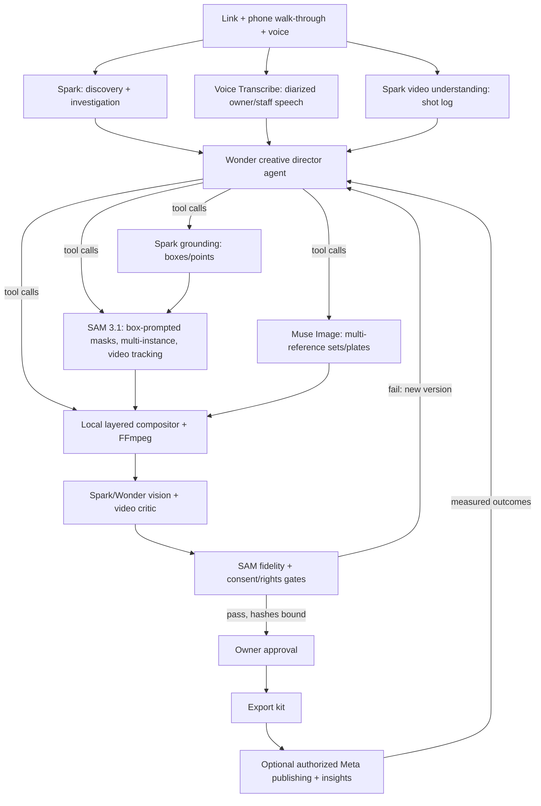

# Tickr — Meta-native capability plan (SAM 3.1 + Muse)

Drafted 4 November 2026 (IST). Revision 2: no deadline constraints, ambitious scope. This is a **proposal**; nothing here is implemented or live-verified yet. [BUILD_PLAN.md](../BUILD_PLAN.md) and [ARCHITECTURE.md](ARCHITECTURE.md) remain the binding contracts until this plan is adopted into them. Every new Meta operation needs its own recorded live probe in [SETUP_VERIFICATION.md](SETUP_VERIFICATION.md) before the product depends on it.

Capability facts come from Meta developer docs retrieved 4 November 2026: [models](https://dev.meta.ai/docs/models), [SAM overview](https://dev.meta.ai/docs/sam/overview), [SAM segmenting](https://dev.meta.ai/docs/sam/segmenting), [SAM cookbook](https://dev.meta.ai/docs/cookbook/sam), [image understanding](https://dev.meta.ai/docs/image-understanding), [video understanding](https://dev.meta.ai/docs/video-understanding), [image generation](https://dev.meta.ai/docs/image-generation), [image edits](https://dev.meta.ai/docs/api-reference/images/edit-image) and [pricing/rate limits](https://dev.meta.ai/docs/pricing-rate-limits). Prices and limits can change, so re-check them before relying on any cost ceiling.

---

## 1. Where the build is today

| Area | What exists | What's left unused |
| --- | --- | --- |
| **SAM 3.1** | One image request per run, one text concept (the offering name), one-bit masks, union of matches, one fixed subject layer. One live probe passed. A saved response passed full rendering. The Tiger Lily live attempt failed and its cause was not retained. | **Video tracking** (≤16 objects per frame, ≤15,000 frames, stable IDs, `propagation_direction`), **box and point prompts** (≤16 objects in one request, negative points), per-object layers, every-instance concept results, `include_confidence`, streaming, the Files API, and SAM as a QA instrument. |
| **Muse Spark 1.3** | Discovery and investigation (native search, ≤5 + ≤10 actions), strict-JSON analysis, copy. | **Grounded image understanding** (points, boxes and counts on a 0–1000 grid, ≤50 images per request), **video understanding** (frames plus embedded audio), tool calling over our own tools, vision critique of rendered output. |
| **Muse Wonder 1.0** | Listed in the catalog, never called. | Long-horizon agent with **parallel tool calls and sub-agents**, 1M context, `max` reasoning effort, plus image, video and audio understanding. |
| **Muse Image 1.0** | `/images/generations`, one inline PNG, tools disabled. Reference editing is implemented but not live-tested. | **Multi-reference composition** (1–10 images per edit), multi-turn editing via Responses, `n` up to 10 variants, a `size` aspect ratio for each placement. |
| **Muse Voice Transcribe** | Not used. | File and **realtime** transcription with diarization, voice-activity detection, keyword biasing, 25 languages and turn timestamps. |
| **Meta platform APIs** | Not used (optional adapters, P2). | With owner authorization: Instagram and Facebook media and insights, Marketing API drafts, and the WhatsApp Cloud API. These close the loop from creative to measured outcome. |
| **Reel** | Four Sharp/SVG scenes plus FFmpeg whole-scene pan/zoom. No subject motion. | Layered motion from real tracked masks, speaker-anchored captions, mask-based transitions, edits cut from the transcript, and variants per audience. |
| **Budget** | Flat cap of 6 Meta requests: 4 text + 2 visual. | A per-role ledger. SAM is very cheap: $2.50 per 1,000 images, $0.20 per 1,000 video frames (minimum 50 frames per request). |

**Diagnosis.** Today Tickr uses SAM as a background remover, its least distinctive use. SAM 3.1's real strengths are finding **every instance** of an open-vocabulary concept, accepting **box and point** prompts, and **tracking objects through video with stable identities**. Tickr's whole philosophy is real pixels, provenance and no fabrication. SAM is the model that lets a business's real products and people move, layer and reframe without a generative model inventing anything. The product should be built around that.

---

## 2. Product thesis

> **Tickr becomes an AI creative studio that turns a shop's own reality into cinema.**
> The owner pastes a link and, optionally, walks the shop with their phone, talking. Wonder directs. Spark researches, watches and points. SAM cuts out and tracks the real cake, the real hands and the real storefront through the owner's own footage. Muse builds sets around them. Voice Transcribe turns the owner's words into evidence and captions. Spark then watches every Reel it made and critiques it. Every product pixel and every claim traces back to a source frame, a source page or a timestamp in the owner's voice.

Six Meta capability families in one loop:

---

## 3. Capability pillars

### Pillar A: "Spark points, SAM cuts" (grounded segmentation)

A text concept such as "Grandma's Victoria sponge" is ambiguous and can return nothing, which may explain the Tiger Lily failure. Merging every match also fuses unrelated objects into one layer.

1. Spark image understanding (≤50 images per request, strict JSON) returns boxes for the named offering, the logo, people and faces, text regions and third-party branding, plus counts of repeated items.
2. Map the 0–1000 grid to source pixels and clamp out-of-range values. Build **one SAM box-prompt request** for up to 16 named objects (`<0f>`, `<|box;…|>`, with `w` and `h` equal to the displayed size).
3. Keep **per-object layers**, each with its own ID, mask, box and `include_confidence`. Do not union them.
4. Fallback order: Spark box → text concept → labelled crop. Retain the raw response and diagnostics for every failure.

Spark's box is a *located observation* and SAM's mask is a *selection*. Neither proves product identity.

### Pillar B: owner footage → tracked real-product cinema (SAM 3.1 video)

1. The owner uploads one or more 10–60 s phone clips, or records them in the browser. Validate the container and codec (MP4/MOV, H.264/H.265), re-mux with `+faststart`, strip GPS and other metadata, and record rights and consent.
2. Upload each clip **once** to the Meta Files API (`purpose: user_data`). Reuse the `file_id` for Spark and SAM, then delete it after the run. Never send an arbitrary remote `video_url`.
3. **Spark video understanding** produces a structured **shot log**: timestamped moments (hero product, process, hands, storefront, interior), steadiness, light, people present and embedded speech.
4. **Spark grounding** on chosen prompt frames returns boxes. **SAM video tracking** then runs with box prompts on those frames and the narrowest `propagation_direction`. It returns masklets for up to 16 objects with stable IDs (product, hands, logo, signage, cup), streamed and keyed by frame marker.
5. Masklets are stored as compressed one-bit frame sequences under `.data/`, hashed and bound to the source clip.

**Cost.** A 30 s clip at 30 fps is 900 frames, about $0.18 of SAM.

### Pillar C: the cinematic compositor (local, deterministic, mask-driven)

Every effect uses real decoded frames multiplied by SAM masks, rendered with Sharp and FFmpeg. There is no generative video.

- **Subject pop-out:** the real product stays sharp while the background is desaturated, darkened, blurred or replaced by a Muse plate.
- **Depth-layered kinetic typography:** words pass *behind* the tracked product and the CTA sits in front, updated per frame from the masklet.
- **Tracked callouts:** offering names, or approved prices only, pinned to the moving object's track.
- **Mask transitions:** a wipe shaped like the product's silhouette, match-cuts between shots of the same object ID, and iris reveals from the subject's centroid.
- **2.5D parallax from stills:** split foreground, midground and background (for example product / counter / room) with several concept or box requests, then move them at different speeds.
- **Subject-aware reframing:** each placement (9:16, 4:5, 1:1, carousel) is cropped from horizontal or vertical footage with a crop window that follows the track centroid, using smoothing and lookahead.
- **Process montage:** with consent, tracked "hands" shots tell a "made by hand" story without inventing a single frame.
- **Animated stickers:** transparent loops of the tracked product for Stories and Status, following the cookbook pattern.

If tracking is lost, the shot ends. The compositor never interpolates or fabricates frames.

### Pillar D: voice-first owner and staff evidence

- **File transcription** of the owner's walk-through audio and voice notes, with **diarization**. **Keyword biasing** uses named offerings and the business name.
- **Realtime "interview mode"** over the realtime WebSocket. Tickr shows its 3 material questions on screen, the owner answers aloud, and owner-stated facts stream in live. Meta has no TTS, so questions stay as text.
- Spark extracts **owner-stated facts**, each linked to an audio timestamp the owner can replay.
- **Speaker-anchored captions:** diarized turns are matched to SAM-tracked people, following the cookbook's multi-speaker captions recipe, and rendered as collision-aware caption bubbles.
- **Edits cut from the transcript:** the director chooses cut points on sentence boundaries, so the Reel uses the owner's real voice and words. The only audio is the owner's own recording, with rights recorded.

### Pillar E: Wonder as the agentic creative director

Replace the fixed linear pipeline after research with a **bounded tool-calling agent** on `muse-wonder-1.0`, using parallel tool calls and sub-agents. All guardrails sit inside the tools, not in the prompt:

| Tool | Executes | Guard inside the tool |
| --- | --- | --- |
| `ground_objects` | Spark vision | Coordinate clamping, schema validation |
| `segment` / `track` | SAM 3.1 | Per-role budget, saved raw response, no auto-retry |
| `make_plate` | Muse Image edits | Empty-set prompt policy, `enable_*` search/shell off, no product pixels |
| `compose_scene` / `render_reel` | Local compositor | Composition-type provenance, text-over-subject check |
| `critique` | Spark/Wonder vision critic | Findings bound to asset hashes |
| `cite` | Evidence ledger lookup | Only supported or owner-confirmed claims can enter copy |

The director plans an **edit decision list** (EDL): shots, object IDs, effects, copy and timing. It executes the list, critiques the result and revises within budget. Sub-agents work in parallel on placements such as the Reel, the carousel and CTWA. The EDL is a persisted, versioned artifact, so every Reel can be explained and reproduced. Exhausting the budget pauses the run with a reason.

### Pillar F: multi-instance "shelf to catalog"

A concept prompt on counter, menu-board or display photos returns every instance. Spark labels all the crops in one request and matches them to offerings in the evidence ledger. Each catalog entry is either *matched to source-named offering X* or *unmatched visual item, needs owner name*.

The owner confirms names with a tap or by voice instead of typing a menu. The catalog feeds the carousel ("4 bakes worth the trip"), Status and the CTWA kit. Counts appear only as observations ("12 items visible in the inspected photo").

### Pillar G: interactive SAM studio

- **Tap to cut:** a tap becomes a point prompt and returns a mask in about 3 s. Negative taps refine the edge. A new object gets a new ID. The selection is recorded as an **owner-confirmed region**.
- **Scrub to track:** the owner pauses a clip, taps the product, chooses "follow this", and gets a live streaming overlay of SAM tracking as frames arrive.
- **Layer panel:** shows every object ID with its mask, confidence and track lifespan, plus toggles for which objects appear in which placement.
- Refinements are user-initiated and budgeted (for example 8 per asset), and never retried automatically.

### Pillar H: Muse Image as set designer, never product painter

- **Multi-reference plates:** the SAM cutout, a storefront or interior frame and the palette go into one edit (1–10 images), which returns an *empty* matched set. The real cutout is then composited locally on top.
- **Variants:** `n` = 3–4 plates for each target ratio. The critic picks one and gives reasons.
- **Seasonal and occasion sets** (Diwali, monsoon, weekend brunch) stay labelled as *proposed* themes, never as an existing promotion.
- **Multi-turn plate refinement** uses `store: false` and replays the prior `image_generation_call`. Web search, image search and shell stay off.
- Contact shadows and reflections are rendered locally from the mask. Product edge pixels are never generated.

### Pillar I: competitive and self visual audit

- **Competitor imagery:** use only permitted official-site reads of competitor pages discovered through Meta-native search. Spark vision and SAM measure observable composition, for example: "In the 14 inspected competitor images, 11 show interiors, 2 show products, 0 show the making process." That supports a bounded differentiation claim, and the inspected sample is always shown.
- **The owner's own feed:** through the authorized Instagram Graph API (opt-in), Spark scores existing posts, SAM finds the recurring hero products, and Tickr reports what the feed over- and under-shows against the selected story.
- Both are observations about the inspected set, never claims about the whole market.

### Pillar J: critic, fidelity and safety gates

- **Vision and video critic:** all stills (≤50 per request) plus each Reel MP4 go to Spark, and the final verdict to Wonder at high effort. It returns strict-JSON findings with severity, the rule broken and a **grounded box**, shown as overlays in the UI. Each revision creates a new version that invalidates the old verdict.
- **SAM fidelity check:** re-segment the final rendered frames and stills. Measure IoU against the expected placement mask and mean ΔE inside the mask against the source cutout. Flag drift.
- **Text-over-subject geometry:** a local check of text boxes against the subject mask on every frame.
- **Consent and rights gates:** SAM and Spark person or face detections require recorded consent. Third-party logos, other businesses' signage and minors block export until the owner resolves them.

These checks are diagnostics. Deterministic rules plus exact-version owner approval still gate readiness.

### Pillar K: variants, publishing and measured learning (authorized Meta APIs)

- **Audience variants:** the director produces 2–3 Reel and caption variants, one per audience hypothesis in the blueprint, sharing tracked assets so the extra SAM cost is zero.
- **Optional, owner-authorized adapters:** Marketing API *drafts* (never activated without explicit approval and budget authorization), Instagram scheduling, and the WhatsApp Cloud API for a CTWA follow-up assistant. That assistant answers only from owner-approved facts in the evidence ledger and hands off to the owner.
- **Insights loop:** with permission, read post and ad insights back and attach them to the variant that produced them. The opportunity report gains measured evidence (*qualified inquiries*, *attended bookings*), and later runs can learn which hooks performed for *this* business. A conversion claim requires a valid measured comparison.

### Pillar L: role-based budget ledger

The worker reserves budget per role, using list rates from the dated pricing page, and records actual usage:

| Role | Default cap per run | Approximate list cost at cap |
| --- | --- | --- |
| Spark text (research, analysis, copy) | 6 | token-metered |
| Spark vision and video (grounding, shot log, catalog, critic) | 6 | token-metered |
| Wonder director and final verdict | 1 session, bounded tool steps (e.g. 40) | token-metered; about 3–5× Spark per token |
| Muse Image | 4 requests, up to 16 images | ≤ $0.16 |
| SAM image (box, concept, layers, QA) | 24 | ≤ $0.06 |
| SAM video | ≤ 4 requests, ≤ 3,600 frames total | ≤ $0.72 |
| SAM interactive refinements | 8 per asset (user-initiated) | ≤ $0.02 per asset |
| Voice transcription | ≤ 10 min | ≤ $0.03 |

The existing rules stay in force: concurrency limit, requested-markers before paid calls, saved raw responses, no automatic retry of uncertain requests, and pause-with-reason before any cap is exceeded. Rate limits per team (SAM 3,000/min, Muse Image 150/min) are not a constraint at this scale.

---

## 4. Architecture changes

| Component | Change |
| --- | --- |
| `lib/meta/files.ts` (new) | Files API upload, reuse and delete on the fixed Meta origin, with bounded sizes and cleanup on failure |
| `lib/meta/grounding.ts` (new) | Spark vision grounding → validated boxes, points and counts in source pixels |
| `lib/meta/segmentation.ts` | Box, point and negative-point prompt builder, multi-object requests, `include_confidence`, video input, streaming parse keyed by frame marker |
| `lib/media/masklets.ts` (new) | Compressed one-bit masklet store, track statistics (lifespan, centroid path, coverage), hash binding |
| `lib/media/uploads.ts` (new) | Owner photo, clip and audio intake: validation, metadata stripping, consent and rights records |
| `lib/meta/voice.ts` (new) | File and realtime transcription, diarization, keyword biasing |
| `lib/agents/director.ts` (new) | Wonder tool loop, EDL schema, sub-agent fan-out, budget-aware tool wrappers |
| `lib/agents/critic.ts` (new) | Multi-image and video critic with grounded findings |
| `lib/campaign/compositor/` (new) | Per-frame layered compositing, kinetic typography, mask transitions, tracked reframing, captions |
| `lib/jobs/store.ts` | Per-role ledger replaces `MAX_MODEL_CALLS` |
| `prisma/` | Tables for uploads, consents, masklets, EDL versions, critic findings, variants and insights |
| UI | Studio (tap to cut, scrub to track, layer panel), interview mode, critic overlays, variant comparison |

The network boundary is unchanged: Meta API host, restricted official-site reader and fixed-host Maps redirect resolver. Platform adapters use owner-scoped Meta tokens, kept separate from research tools.

---

## 5. Phased delivery

Each phase exits only with live evidence recorded in SETUP_VERIFICATION, not mocked tests.

| Phase | Scope | Exit evidence |
| --- | --- | --- |
| **1. Grounded segmentation** | Pillar A, per-object layers, tracked-reframe for stills, text-over-subject check, per-role ledger | Live box-prompt runs on real source images, including Tiger Lily; failure rates for box vs concept prompts recorded |
| **2. Owner media and voice** | Uploads and consent, Files API, voice file transcription, owner-stated facts with timestamps | One real walk-through clip and voice note ingested; facts link back to audio |
| **3. SAM video and cinematic compositor** | Shot log, SAM tracking, masklet store, Pillar C effects, speaker captions | A Reel built from real tracked footage; `ffprobe` and frame inspection; fidelity IoU and ΔE reported |
| **4. Director and critic** | Wonder director with EDL, Spark/Wonder critic with overlays, a bounded revision loop | One run where the critic catches a real defect and the revision passes with re-bound hashes |
| **5. Studio UI and catalog** | Tap to cut, scrub to track, layer panel, shelf to catalog, realtime interview mode, Muse multi-reference plates | Owner-confirmed regions and catalog names persisted; plates chosen by the critic |
| **6. Audit and variants** | Competitor and self visual audit, audience variants | Audit tables with sample sizes; variants sharing tracked assets |
| **7. Authorized platform loop** | Marketing API drafts, IG scheduling, CTWA assistant, insights read-back | Requires explicit owner authorization; nothing goes live without it |
| **8. Evaluation** | Frozen-input baseline vs full pipeline, five or more businesses, blind human review | Actual scores, failures, latency and spend reported, including misses |

---

## 6. Guardrails that must not slip

- **Meta-only inference.** All new calls go to `api.meta.ai` with keys kept server-side. Media is sent inline or through the Meta Files API, then deleted. No open-weight or local inference: Muse Spark Open and Glimmer are excluded.
- **No generated product or people pixels.** SAM masks only select real pixels. Muse makes empty sets only. Every asset records its composition type.
- **No generated footage presented as real.** Motion comes from real clips. Plates and illustrations are labelled.
- **Consent and rights.** Detected people need recorded consent. Third-party logos and signage, and minors, block export.
- **Provenance classes.** Spark boxes are *located observations*, SAM masks are *selections*, owner taps are *owner-confirmed regions*, voice is *owner-stated* with timestamps, and insights are *measured outcomes*. None of these on its own verifies a product claim or an offer.
- **Platform actions.** No publishing, ad spend or outbound messaging without explicit, scoped owner authorization.
- **Honest numbers.** Costs are dated list prices until actual usage is recorded. Fixtures and replays never count as live capability.

---

## 7. Open verification questions

1. Do SAM box prompts succeed where text concepts failed? Probe this on the Tiger Lily source image with a saved raw response.
2. What are this account's Files API size limits and retention, and what is SAM video latency for a 900-frame clip when streamed?
3. Does `/v1/images/edits` multi-reference keep a set's light and palette faithfully enough for plates? Editing is still unverified.
4. Is Spark grounding accurate on small products in busy counter photos? Measure box-to-mask agreement.
5. Is the Wonder director's quality gain over a fixed Spark pipeline worth its cost and latency? Measure it on frozen inputs.
6. Does Voice Transcribe diarization separate owner and staff reliably enough for speaker-anchored captions on noisy shop audio?
