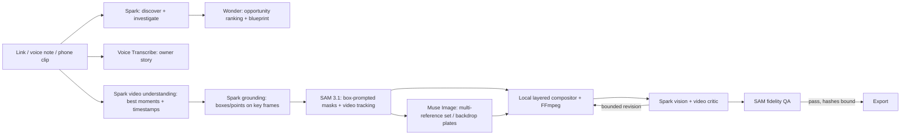

# Tickr — Meta-native capability plan (SAM 3.1 + Muse)

Drafted 4 November 2026 (IST). This is a **proposal**. Nothing in it is implemented or live-verified yet. [BUILD_PLAN.md](../BUILD_PLAN.md) and [ARCHITECTURE.md](ARCHITECTURE.md) remain the contracts. Every new operation below needs its own recorded capability probe in [SETUP_VERIFICATION.md](SETUP_VERIFICATION.md) before the product depends on it.

Capability facts come from Meta's developer docs, retrieved 4 November 2026: [models](https://dev.meta.ai/docs/models), [SAM overview](https://dev.meta.ai/docs/sam/overview), [SAM segmenting](https://dev.meta.ai/docs/sam/segmenting), [SAM cookbook](https://dev.meta.ai/docs/cookbook/sam), [image understanding](https://dev.meta.ai/docs/image-understanding), [video understanding](https://dev.meta.ai/docs/video-understanding), [image generation](https://dev.meta.ai/docs/image-generation), [image edits](https://dev.meta.ai/docs/api-reference/images/edit-image) and [pricing/rate limits](https://dev.meta.ai/docs/pricing-rate-limits). Prices and limits can change, so re-check them before relying on any cost ceiling.

---

## 1. Where the build is today

| Area | What exists | What's left unused |
| --- | --- | --- |
| **SAM 3.1** | One image request per run, one text concept (the offering name), one-bit masks, union of matches, one fixed subject layer. One live probe passed. A saved response passed full rendering. The Tiger Lily live attempt failed and its cause was not retained. | Video input and **cross-frame tracking**, **box and point prompts** (up to 16 objects in one request), stable object IDs, per-object (not unioned) layers, confidence-driven selection, `propagation_direction`, the Files API, and SAM as a QA instrument. |
| **Muse Spark 1.3** | Discovery and investigation (native search, ≤5 + ≤10 actions), strict-JSON analysis, copy. | **Image understanding with grounded coordinates** (points, boxes and counts on a 0–1000 grid, up to 50 images per request), **video understanding** (frames plus embedded audio), visual critique of our own rendered output. |
| **Muse Image 1.0** | `/images/generations`, one inline PNG, tools disabled. JSON reference editing is implemented but not live-tested. | **Multi-reference composition** (1–10 images per edit), multi-turn editing via Responses, `n` > 1 for variants, `size` aspect-ratio control for each placement. |
| **Muse Wonder 1.0** | Listed in the catalog, never called. | Highest-effort reasoning for the one or two decisions that matter most: opportunity ranking and the final critic. |
| **Muse Voice Transcribe** | Not used. | Owner voice notes in 25 languages with turn timestamps, as a low-friction **owner-stated** evidence channel. |
| **Reel** | Four Sharp/SVG scenes plus FFmpeg whole-scene pan/zoom. No subject motion. | Layered motion from real tracked masks: subject pop-out, text behind the subject, tracked callouts, background treatment and subject-aware reframing. |
| **Budget** | Flat cap of 6 Meta requests: 4 text + 2 visual. | A per-role ledger that SAM's pricing makes cheap: $2.50 per 1,000 images and $0.20 per 1,000 video frames (minimum 50 frames per request). |

**Diagnosis.** Today SAM is used as a background remover, which is its weakest showcase. SAM 3.1's distinctive strengths are open-vocabulary concept segmentation of **every instance**, **prompting by box and point**, and **tracking objects through video with stable identities**. Tickr's whole philosophy is real pixels, provenance and no fabrication. SAM is exactly the model that lets real products move, layer and reframe without a generative model inventing anything. That is the story to build around.

---

## 2. Product thesis

> **"Your real shop, cinematically produced, with zero invented pixels on the product."**
> The owner pastes a link and, optionally, records a 20-second phone clip or voice note. Spark finds the story. Spark sees and points at the product. SAM cuts it out and tracks it through the owner's own footage. Muse builds the set around it. Spark then watches the finished Reel and critiques it. Every product pixel in the final kit can be traced back to a source frame.

Five Meta models work in one flow, each in the role it is strongest at:

---

## 3. Capability pillars

### Pillar A: "Spark points, SAM cuts" (grounded segmentation)

**Problem.** A text concept such as "Grandma's Victoria sponge" is ambiguous for SAM and can return nothing, as the Tiger Lily failure may illustrate. A union of every match also merges unrelated objects into one layer.

**Design.**
1. Send each candidate source image (official-site media and owner uploads, up to 50 per request) to Spark image understanding with strict JSON output. Ask for the named offering's box, the logo box, people and faces, embedded text regions, competitor or third-party branding, and a count of repeated items.
2. Convert Spark's 0–1000 coordinates into source pixels, clamping values such as 1001. Build **one SAM box-prompt request** covering up to 16 named objects (`<0f>` frame marker, `<|box;…|>` tokens, with `w` and `h` equal to the displayed size).
3. Keep **per-object layers**, each with its own object ID, mask, box and `include_confidence`. Do not union them. The compositor can then place the product, the logo and a secondary item independently.
4. Fallback order: Spark-box prompt → text-concept prompt → labelled crop. Retain the raw response and diagnostics for every failure, so a failure like Tiger Lily's is always explainable.

**Why it matters.** It makes segmentation dramatically more reliable. A single SAM call can serve many uses, and the box ties every mask to a model-grounded label that the evidence ledger can store as an image-region provenance record. Spark's box is a *located claim*, not proof of identity.

**Cost.** One Spark vision call plus one SAM image call (about $0.0025).

### Pillar B: owner phone clip → tracked real-product motion (SAM 3.1 video)

This is the headline feature.

**Flow.**
1. The owner uploads a 10–30 s phone clip: the product on the counter, the tray coming out of the oven, the storefront. Validate it as MP4/MOV with H.264/H.265, apply size and duration limits, re-mux with `-movflags +faststart`, and strip location metadata.
2. Upload the clip **once** to the Meta Files API (`purpose: user_data`) and reuse the same `file_id` for both Spark and SAM. Delete the file after the run. Never use `video_url` with an arbitrary remote host.
3. **Spark video understanding** returns structured shots: the best hero moment, an action moment, steadiness, lighting, whether people or faces appear, and a transcript of embedded speech. All of it is stored as *observed signal*, not fact.
4. **Spark grounding** on the chosen prompt frame produces a box for the product (and the logo, if present).
5. **SAM 3.1 video tracking** takes box prompts on frame N with `propagation_direction` set to the narrowest needed window (`forward` from the hero moment). It returns masklets for up to 16 objects with stable IDs, streamed frame by frame.
6. A local compositor uses the masklets, with no generative video:
   - **Subject pop-out:** the real product stays sharp while the background is desaturated, darkened, blurred or replaced by a Muse plate.
   - **Depth layering:** the headline sits *behind* the product and the CTA in front.
   - **Tracked callouts:** an offering name or approved price tag pinned to the moving product (shown only when evidence permits it).
   - **Subject-aware reframe:** horizontal footage converted to 9:16, 4:5 and 1:1 with the crop window following the track centroid.
   - **Animated sticker loops** for Stories and Status, following the Meta cookbook's "video to animated stickers" pattern.
7. The Reel becomes hook (real footage, tracked pop-out) → proof (product close-up) → value (story line from the owner's voice) → CTA. The existing four-scene contract stays and gains real subject motion.

**Integrity rules.** Product pixels are always decoded source frames multiplied by the mask. Generated plates are labelled as generated. Any frame with people requires a recorded owner consent statement before export. If tracking is lost (an object drops out), cut to the next scene. Never interpolate or fabricate frames.

**Cost.** A 10 s clip at 30 fps is about 300 frames, roughly $0.06 of SAM tracking. This is the cheapest high-impact item in the plan.

**Prerequisite.** Owner uploads (still open in BUILD_PLAN §12) need validation, rights and consent records, and private storage under `.data/`.

### Pillar C: interactive "tap to cut" refinement

In the workspace, the owner taps a product in a photo or on a paused video frame. That tap becomes a SAM point prompt. A mask preview appears within seconds (the probe measured about 3.2 s). Tapping where the mask is wrong adds a negative point (`-<|point…|>`). Selecting a different object starts a new object ID.

- This gives the owner direct control over what counts as "the product". The selection is recorded as **owner-confirmed region**, a stronger provenance than any model guess.
- It makes for a memorable live demo moment that clearly shows SAM.
- Each refinement is a separate, explicitly user-initiated request with its own small budget, for example 8 refinements per asset. Refinements are never auto-retried.

### Pillar D: multi-instance "shelf to catalog"

A concept prompt returns **every instance** in an image. Running "cake", "loaf" or "pastry" on a display-counter photo produces one crop per item. Spark (with all crops in a single request) labels each crop and matches it against named offerings from the evidence ledger.

- The output is a visual catalog. Each entry is either *matched to source-named offering X* or *unmatched visual item (needs owner name)*. This attacks the "no named offering" gap seen in Grandma Daphne's run: the owner confirms names instead of typing a menu.
- The catalog feeds carousel slides ("4 bakes worth the trip"), Status creative and the CTWA conversation kit.
- Counts appear only as observations ("12 items visible in the inspected photo"), never as menu size or inventory.

### Pillar E: Muse Image as set designer, never product painter

- **Multi-reference plates:** pass the SAM cutout, a storefront or interior photo, and the palette swatch (1–10 images per edit) to request an *empty* set that matches the shop's light and colour. Then composite the real cutout locally on top. Muse never repaints the product.
- **Variants:** use `n` = 3 backdrop candidates per placement, all for one $0.01-per-image request group, with `size` matched to each target ratio (`1024x1536` for 9:16 and 4:5, a square size for 1:1). Spark picks the best plate (Pillar F), with reasons.
- **Multi-turn edits:** chain plate edits with `store: false` and replay of the prior `image_generation_call`, not stored server state. Keep `enable_web_search`, `enable_image_search` and `enable_shell` **false**, as today.
- Contact shadow and reflection are rendered locally from the mask (blur plus offset), not generated, so the product's edge pixels stay untouched.
- Live-test the edit endpoint before depending on it. It is implemented but unverified today.

### Pillar F: Spark (or Wonder) as a vision-and-video critic

The planned "contextual final critique" is now concrete:

1. Send **all rendered stills** (up to 50 images in one request) plus the **final Reel MP4** (video understanding) to Spark, together with the blueprint and the evidence IDs.
2. The critic returns strict JSON: per-asset findings with severity, the rule broken (claim traceability, unapproved offer, unreadable text, CTA missing or occluded, brand inconsistency, review language leaking into consumer copy, people without consent) and **grounded boxes** pointing at the problem.
3. The UI overlays those boxes on the asset. A revision creates a new version, which invalidates the old verdict (an existing rule).
4. Use **Wonder at high reasoning effort** only for the final verdict and for opportunity ranking. Use Spark everywhere else. The model used for each verdict is disclosed in the QA report.
5. The critic stays a diagnostic. Deterministic checks and owner approval still gate readiness.

### Pillar G: SAM as a deterministic fidelity instrument

This turns "we preserve the real product" from a claim into a measured property:

- **Re-segmentation check:** run SAM on the final rendered asset with the same box or concept. Compare the mask with the expected placement mask (IoU), and compare the pixels inside it with the resized source cutout (mean ΔE). Flag drift above a threshold.
- **Text-over-subject check:** compare the layout's own text boxes with the subject mask to catch headlines covering the product. This is local geometry, with no model call.
- **People and logo gate:** run SAM concept requests for "person", "face" and "logo" on source media. Any hit raises a consent or third-party-rights item that the owner must resolve before export.

These checks are diagnostics, not identity proof. The architecture already states this, and the QA report must repeat it.

### Pillar H: owner voice as first-class evidence

The owner can record a 60-second note ("Tell us your story / what you want people to know"). Muse Voice Transcribe turns it into a transcript with turn timestamps (it supports 25 languages, which matters for Indian shop owners). Spark then extracts **owner-stated facts** such as founder story, signature item and opening hours. Each fact links to its audio timestamp, so the owner can replay exactly where they said it.

- This fills the gap where research "remains unknown" without asking the owner to type.
- The owner's actual words can drive the Reel's on-screen story line, with on-screen captions generated locally. Tickr cannot speak in the owner's voice because Meta offers no text-to-speech and no external TTS is permitted. Any optional audio is the owner's own recording.
- Cost: $0.18 per hour of audio, so a minute costs about $0.003.

### Pillar I: role-based budget ledger

Replace the flat 6-request cap with per-role reservations, using rates retrieved 4 November 2026 and re-checked at run time:

| Role | Default cap per run | Approximate list cost at cap |
| --- | --- | --- |
| Spark text (discover, investigate, analyse, copy) | 4 | token-metered; record actual usage |
| Spark vision (grounding + catalog) | 2 | token-metered |
| Spark or Wonder critic (stills + Reel) | 2 (1 revision) | token-metered; Wonder is about 3–5× Spark per token |
| Muse Image | 2 requests, up to 6 images | ≤ $0.06 |
| SAM image (box, concept or QA) | 8 | ≤ $0.02 |
| SAM video | 1 request, ≤ 900 frames | ≤ $0.18 |
| SAM interactive refinements | 8 per asset (user-initiated) | ≤ $0.02 |
| Voice transcription | ≤ 3 min | ≤ $0.01 |

The existing rules stay in force: concurrency limit, requested-markers before paid calls, no automatic retry of uncertain requests, saved raw responses, and pause-with-reason when a cap would be exceeded. Rate limits per team (SAM 3,000/min, Muse Image 150/min) are not a constraint at this scale.

---

## 4. What the demo should show

The judging weights are Impact 30, Meta tooling 25, Technical depth 20 and Demo 25. A run should show, in this order:

1. Paste the Grandma Daphne's link → live discovery trace (existing).
2. Record a voice note ("my grandmother's recipe…") → transcript with timestamped owner-stated facts (Pillar H).
3. Upload a 15 s phone clip of a cake → Spark marks the hero moment; **SAM tracks the cake; the on-screen mask overlay follows it** (Pillar B).
4. Tap to fix a mask edge with a negative point (Pillar C).
5. The Reel plays with the real cake popping out of a Muse-built set and the headline behind it, reframed to every placement (Pillars B and E).
6. The Spark critic flags one problem with a box overlay. Revision → new version → the verdict re-binds to the new hashes (Pillar F, honouring the "one actual failure/correction" demo requirement).
7. The fidelity report shows the SAM re-segmentation IoU and ΔE on the product region (Pillar G).
8. Export the ZIP with its provenance map.

If the real owner footage is not authorized, use a clip the team filmed and owns. Label it as such and **never** present it as the business's footage.

---

## 5. Sequenced delivery

The submission buffer is **20:00 IST on 4 November** and the stated deadline is 07:30 IST on 5 November. Hours remain, not days, so the order below puts reliability and demo value first. Each item exits only with a live probe recorded in SETUP_VERIFICATION.

### Tier 0: before submission (small, high-leverage, low-risk)

| # | Work | Touches | Exit evidence |
| --- | --- | --- | --- |
| 0.1 | Spark grounding → SAM **box prompts**, with per-object layers and text-concept fallback (Pillar A) | `lib/meta/segmentation.ts` (box/point prompt builder), new `lib/meta/grounding.ts`, `lib/campaign/layers.ts` | One live run on a real source image: box → mask, raw response saved |
| 0.2 | Subject-aware reframing of stills from mask and box (local only) | `lib/campaign/render.ts` | `npm run media:check`; subject never cropped in 4:5, 1:1 and 9:16 |
| 0.3 | Text-over-subject geometry check plus SAM re-segmentation fidelity check | `lib/campaign/render.ts`, QA report | Report fields populated; offline test with the saved response |
| 0.4 | Spark vision critic on the final stills (one request, grounded findings) | new `lib/agents/critic.ts` | One live critique bound to asset hashes |
| 0.5 | Budget ledger split by role (keep the total conservative) | `lib/jobs/store.ts` | Unit tests for reservation and exhaustion |

### Tier 1: video and owner input (first post-submission sprint)

1. Owner upload pipeline for photos, clips and voice, with type, size and duration validation, metadata stripping, a consent record and private storage.
2. Files API adapter (upload, reuse, delete) on the fixed Meta origin.
3. Spark video understanding → shot plan JSON.
4. SAM video tracking adapter (streaming parse keyed by frame marker, minimal `propagation_direction`), with masklets stored as compressed one-bit frames under `.data/`.
5. Layered Reel compositor in FFmpeg using per-frame alpha mattes: pop-out, text behind the subject, tracked callout, reframe.
6. Voice Transcribe → owner-stated facts with timestamps.

### Tier 2: interaction and catalog

1. Tap-to-cut UI with positive and negative points and a live preview.
2. Shelf-to-catalog multi-instance extraction and the owner naming flow.
3. Muse multi-reference set plates with `n` variants and critic selection.
4. Reel critic (Spark video understanding on the final MP4) and Wonder for the final verdict.
5. Animated sticker export for Stories and Status.

### Tier 3: evaluation

- Run the frozen-input baseline (direct Muse generation) against the full pipeline across the four example verticals plus one outside them. Measure blind human scores for visual authenticity, and SAM-fidelity IoU and ΔE.
- Record live failure rates for box-prompted versus concept-prompted segmentation. This answers the open Tiger Lily question with data.

---

## 6. Guardrails that must not slip

- **Meta-only inference.** All new calls go to `api.meta.ai` with keys kept server-side. Video and images are sent inline or through the Meta Files API, never as third-party `video_url` or `image_url` values. Files are deleted after the run.
- **No generated product pixels.** SAM masks only *select* real pixels. Muse makes sets and plates only. Every asset records its composition type.
- **No generated video presented as footage.** Tracked motion is real footage. Synthetic plates are labelled.
- **People and rights.** SAM or Spark person and face detections require owner consent before export. Third-party logos raise a rights item.
- **Provenance.** Spark boxes are *located observations*, SAM masks are *selections*, owner taps are *owner-confirmed regions* and voice facts are *owner-stated* with timestamps. None of these on its own verifies a product claim or an offer.
- **Budget honesty.** Record actual usage. Cost figures above are list prices from the dated pricing page, not measured spend.
- **Fixtures are not proof.** A saved-response replay of any new adapter does not count as live capability.

---

## 7. Open verification questions

1. Do SAM box prompts succeed where text concepts failed? Probe this on the Tiger Lily source image with a saved raw response.
2. What are the SAM video request size and duration limits through the Files API, and how long is uploaded-file retention for this account?
3. Does `/v1/images/edits` preserve a reference set's light and palette well enough for plates? This needs a live test, because editing is unverified.
4. What is Wonder's latency at high effort for a 20-image critique? Is it worth the extra cost over Spark? Measure before adopting it.
5. Is Spark grounding accuracy on small products in busy counter photos good enough to seed SAM boxes? Measure box-to-mask agreement.
